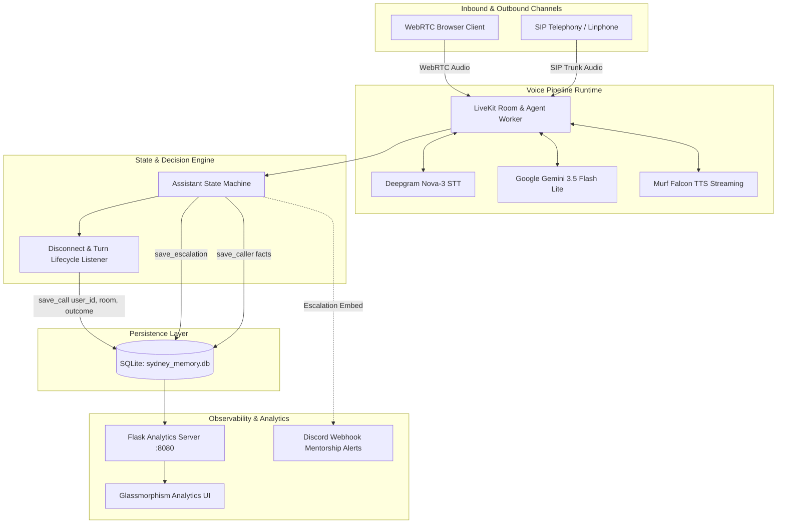
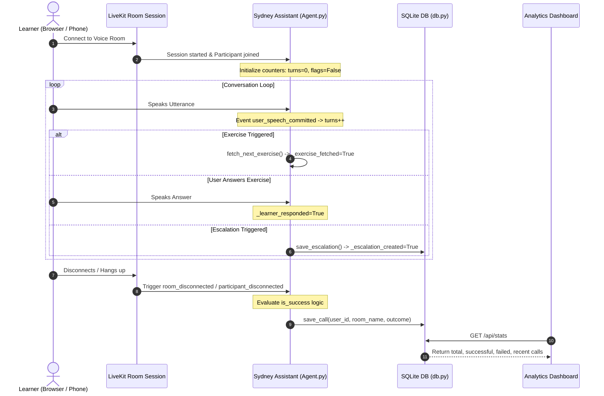
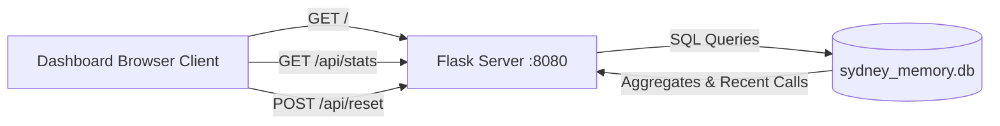

# System Design: Day 8 — Call Analytics Dashboard & Outcome Evaluation

**Track:** Learning & Literacy
**Agent:** Sydney — AI/ML Learning Companion
**Challenge:** 10 Days of AI Voice Agents (Voice for Bharat Challenge 2026)
**Core Technologies:** LiveKit Agents, Murf Falcon TTS, Deepgram Nova-3 STT, Google Gemini, SQLite, Flask

---

## 1. Executive Summary & Objective

In Day 8 of the *Voice for Bharat Challenge*, the conversational voice agent **Sydney** is extended with an end-to-end **Call Analytics & Outcome Evaluation System**. The system tracks every inbound WebRTC and outbound SIP telephony call, programmatically evaluates whether the call fulfilled pedagogical success criteria, persists analytics into an embedded SQLite database, and surfaces real-time metrics via a lightweight, privacy-conscious Flask analytics dashboard.



---

## 2. High-Level Architecture & Components

The solution is partitioned into four primary layers:

### 2.1. Client & Ingestion Layer

1. **Next.js WebRTC Frontend (`frontend/`):** Browser-based voice interface utilizing LiveKit Agents UI components and Web Audio visualizers.
2. **SIP / Telephony Bridge (`backend/src/dial.py`):** Outbound telephony initiator connecting LiveKit SIP participant dispatch to carrier trunks.
3. **Analytics Dashboard UI (`backend/src/dashboard.py`):** Self-contained, responsive web interface serving metric cards, real-time call history, and reset controls.

### 2.2. Voice Agent Pipeline Layer (`backend/src/agent.py`)

- **Transport & Orchestration:** [LiveKit Agents SDK](file:///c:/Users/suyas/Downloads/CODING%281%29/10-days-of-AI-voice-agents-voice-for-bharat-challenge-2026/backend/src/agent.py#L11-L25) managing real-time media streaming, room topologies, and participant lifecycles.
- **Speech-to-Text (STT):** [Deepgram Nova-3](file:///c:/Users/suyas/Downloads/CODING%281%29/10-days-of-AI-voice-agents-voice-for-bharat-challenge-2026/backend/src/agent.py#L372) (`model="nova-3"`, `language="multi"`) for high-accuracy multilingual audio transcription.
- **Language Intelligence (LLM):** [Google Gemini 3.5 Flash Lite](file:///c:/Users/suyas/Downloads/CODING%281%29/10-days-of-AI-voice-agents-voice-for-bharat-challenge-2026/backend/src/agent.py#L373) calibrated for short-sentence spoken dialogue, concept distillation, and tool calling.
- **Text-to-Speech (TTS):** [Murf Falcon](file:///c:/Users/suyas/Downloads/CODING%281%29/10-days-of-AI-voice-agents-voice-for-bharat-challenge-2026/backend/src/agent.py#L374-L379) (`voice="Anisha"`, `style="Conversation"`) providing ultra-low model latency (~55ms) and streaming audio generation with sentence-level tokenization.
- **Voice Activity & Turn Detection:** Silero VAD prewarmed in background worker alongside LiveKit multilingual turn detection model to handle natural turn-taking and barge-in.

### 2.3. Agent Assistant & State Machine (`backend/src/agent.py:Assistant`)

The [`Assistant`](file:///c:/Users/suyas/Downloads/CODING%281%29/10-days-of-AI-voice-agents-voice-for-bharat-challenge-2026/backend/src/agent.py#L131-L353) class tracks internal session progress:

- `_user_turns`: Monotonically increasing counter updated on each committed user utterance.
- `_exercise_fetched`: Boolean set to `True` when [`fetch_next_exercise`](file:///c:/Users/suyas/Downloads/CODING%281%29/10-days-of-AI-voice-agents-voice-for-bharat-challenge-2026/backend/src/agent.py#L186-L228) succeeds.
- `_learner_responded`: Boolean triggered if user speaks following an exercise delivery.
- `_escalation_created`: Flag indicating learner consented to mentor handover via [`create_escalation`](file:///c:/Users/suyas/Downloads/CODING%281%29/10-days-of-AI-voice-agents-voice-for-bharat-challenge-2026/backend/src/agent.py#L230-L343).
- `_fact_saved`: Flag indicating learner profile information was stored via [`remember_caller_fact`](file:///c:/Users/suyas/Downloads/CODING%281%29/10-days-of-AI-voice-agents-voice-for-bharat-challenge-2026/backend/src/agent.py#L158-L184).

### 2.4. Data & Observability Layer (`backend/src/db.py` & `backend/src/dashboard.py`)

- SQLite database (`sydney_memory.db`) housing caller profiles, mentorship escalations, and call analytics.
- Flask HTTP server exposing JSON endpoints and static dashboard view.

---

## 3. Call Lifecycle & Outcome Evaluation Flow



---

## 4. Call Success vs. Failure Criteria

In accordance with Step 1 of the Day 8 specification for the **Learning & Literacy** track, call success is rigorously defined by pedagogical progress rather than simple network uptime:

$$
\text{is\_success} = (\text{user\_turns} \ge 2) \lor (\text{exercise\_fetched} \land \text{learner\_responded}) \lor \text{escalation\_created} \lor \text{fact\_saved}
$$

| Outcome Category                         | Success Condition Satisfied? | Description                                                                                                                                              |
| :--------------------------------------- | :--------------------------: | :------------------------------------------------------------------------------------------------------------------------------------------------------- |
| **Active Multi-turn Dialogue**     |      **Success**      | Learner engaged in at least 2 full turns ($\ge 2$ utterances), signifying active learning and calibration.                                             |
| **Interactive Exercise Completed** |      **Success**      | Agent presented a conceptual quiz/exercise and learner actively attempted or answered verbally.                                                          |
| **Managed Human Escalation**       |      **Success**      | Learner experiencing acute distress or requesting a mentor received a structured reference ID (`ESC-...`) with consent.                                |
| **Learning Profile Stored**        |      **Success**      | Learner explicitly gave consent to record their learning goal or prior knowledge for future recall.                                                      |
| **Early Drop-off / Dead Call**     |       **Failed**       | Call connected but caller hung up before speaking or spoke only a single isolated greeting/syllable ($< 2$ turns) without exercise or profile updates. |
| **Immediate Abandonment**          |       **Failed**       | Callee hung up during initial agent greeting without reciprocal dialogue.                                                                                |

---

## 5. Database Schema & Data Models

All state is persisted in an embedded SQLite database (`backend/src/sydney_memory.db`) managed through [`backend/src/db.py`](file:///c:/Users/suyas/Downloads/CODING%281%29/10-days-of-AI-voice-agents-voice-for-bharat-challenge-2026/backend/src/db.py).

### 5.1. Table: `calls` (Day 8 Analytics Core)

Records every session lifecycle outcome:

```sql
CREATE TABLE IF NOT EXISTS calls (
    id INTEGER PRIMARY KEY AUTOINCREMENT,
    user_id TEXT,
    room_name TEXT,
    outcome TEXT,                              -- 'success' | 'failed'
    started_at TIMESTAMP DEFAULT CURRENT_TIMESTAMP,
    ended_at TIMESTAMP
);
```

### 5.2. Table: `callers` (Day 4/5 Memory & Identity)

Stores long-term learner profile facts and consent status:

```sql
CREATE TABLE IF NOT EXISTS callers (
    user_id TEXT PRIMARY KEY,
    name TEXT,
    last_topic TEXT,
    facts TEXT,
    opted_out INTEGER DEFAULT 0,
    updated_at TIMESTAMP DEFAULT CURRENT_TIMESTAMP
);
```

### 5.3. Table: `escalations` (Day 7 Human Escalation)

Stores human mentor requests triggered with explicit consent:

```sql
CREATE TABLE IF NOT EXISTS escalations (
    ref_id TEXT PRIMARY KEY,
    user_id TEXT,
    name TEXT,
    reason TEXT,                               -- 'learner_distressed' | 'requested_human_teacher'
    summary TEXT,
    language TEXT,
    follow_up TEXT,
    status TEXT DEFAULT 'open',
    created_at TIMESTAMP DEFAULT CURRENT_TIMESTAMP
);
```

---

## 6. Dashboard Architecture & Privacy Controls

The analytics dashboard is implemented in [`backend/src/dashboard.py`](file:///c:/Users/suyas/Downloads/CODING%281%29/10-days-of-AI-voice-agents-voice-for-bharat-challenge-2026/backend/src/dashboard.py) as an embedded Flask service serving single-page HTML/CSS/JS.



### 6.1. API Endpoints

- **`GET /`**: Serves the single-page HTML application with glassmorphic dark-theme design.
- **`GET /api/stats`**: Returns real-time aggregate metrics and latest 10 calls:
  ```json
  {
    "total": 12,
    "successful": 10,
    "failed": 2,
    "recent": [
      {
        "user_id": "+919876543210",
        "room_name": "outbound-call-a4f1082c",
        "outcome": "success",
        "ended_at": "2026-08-13 18:42:10"
      }
    ]
  }
  ```
- **`POST /api/reset`**: Truncates `calls` table for testing and demonstration workflows.

### 6.2. Privacy & Caller Data Protection (Step 6 Compliance)

To prevent unauthorized leakage of Personally Identifiable Information (PII):

1. **User Identity Masking:** The dashboard client trims and truncates raw caller IDs and phone numbers:
   ```javascript
   const uid = c.user_id ? c.user_id.substring(0, 8) + '...' : 'unknown';
   ```
2. **Exclusion of Sensitive Transcripts:** Audio recordings, raw transcripts, OTPs, PINs, and credentials are never stored in the `calls` table and never delivered over `/api/stats`.
3. **Escalation Data Segregation:** Qualitative escalation notes and user profiles reside in separate restricted tables (`escalations`, `callers`), isolated from the public analytics view.

---

## 7. Execution & Verification Guide

### 7.1. Starting the Voice Agent & Dashboard

From the repository root:

```bash
# Terminal 1: Run the Voice Agent Worker
cd backend
uv run python src/agent.py dev

# Terminal 2: Run the Call Analytics Dashboard
cd backend
uv run python src/dashboard.py
```

The dashboard is accessible at: `http://localhost:8080`.

### 7.2. Testing the Success Path

1. Connect to Sydney via browser frontend (`http://localhost:3000`) or outbound dialer:
   ```bash
   uv run python src/dial.py --to +91XXXXXXXXXX
   ```
2. Speak with Sydney for at least 2 conversational turns (e.g., discuss RAG or embeddings).
3. Hang up the call.
4. Refresh the dashboard (`http://localhost:8080`):
   - **Total calls** increments by +1.
   - **Successful calls** increments by +1.
   - Call appears in **Recent Calls** with green `Success` badge.

### 7.3. Testing the Failure Path

1. Initiate a call.
2. Immediately terminate or disconnect before speaking or after a single turn without completing an exercise or escalation.
3. Refresh the dashboard:
   - **Total calls** increments by +1.
   - **Failed calls** increments by +1.
   - Call appears in **Recent Calls** with pink `Failed` badge.

---

## 8. Summary of Components & Key Files

| Component                     | Path                                                                                                                                                                        | Description                                                                                  |
| :---------------------------- | :-------------------------------------------------------------------------------------------------------------------------------------------------------------------------- | :------------------------------------------------------------------------------------------- |
| **Agent Worker**        | [`backend/src/agent.py`](file:///c:/Users/suyas/Downloads/CODING%281%29/10-days-of-AI-voice-agents-voice-for-bharat-challenge-2026/backend/src/agent.py)                   | LiveKit session lifecycle, turn tracker, Murf Falcon voice, and success evaluation.          |
| **Analytics Dashboard** | [`backend/src/dashboard.py`](file:///c:/Users/suyas/Downloads/CODING%281%29/10-days-of-AI-voice-agents-voice-for-bharat-challenge-2026/backend/src/dashboard.py)           | Lightweight Flask application serving the Call Analytics UI and`/api/stats`.               |
| **Database Operations** | [`backend/src/db.py`](file:///c:/Users/suyas/Downloads/CODING%281%29/10-days-of-AI-voice-agents-voice-for-bharat-challenge-2026/backend/src/db.py)                         | SQLite schema migrations and CRUD operations for`calls`, `callers`, and `escalations`. |
| **Outbound SIP Agent**  | [`backend/src/outbound_agent.py`](file:///c:/Users/suyas/Downloads/CODING%281%29/10-days-of-AI-voice-agents-voice-for-bharat-challenge-2026/backend/src/outbound_agent.py) | Agent entrypoint for proactive outbound telephony sessions.                                  |
| **SIP Call Dispatcher** | [`backend/src/dial.py`](file:///c:/Users/suyas/Downloads/CODING%281%29/10-days-of-AI-voice-agents-voice-for-bharat-challenge-2026/backend/src/dial.py)                     | CLI utility to trigger telephony calls via LiveKit SIP trunk.                                |
| **Practice Exercises**  | [`backend/src/exercises.json`](file:///c:/Users/suyas/Downloads/CODING%281%29/10-days-of-AI-voice-agents-voice-for-bharat-challenge-2026/backend/src/exercises.json)       | Pedagogical questions and hints for evaluating concept understanding.                        |
